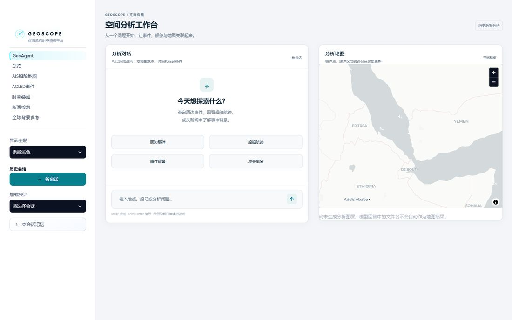
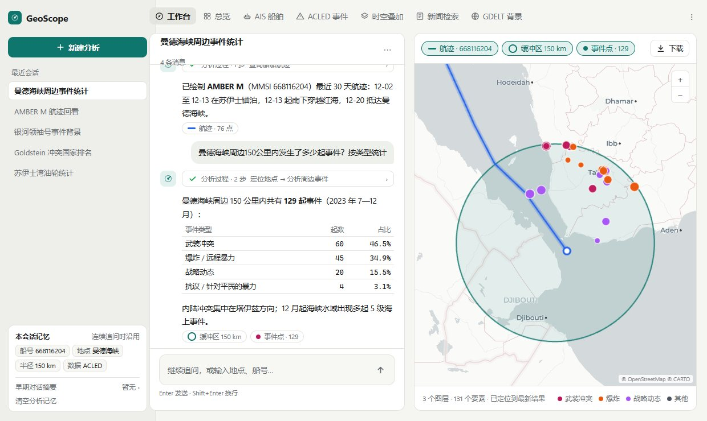
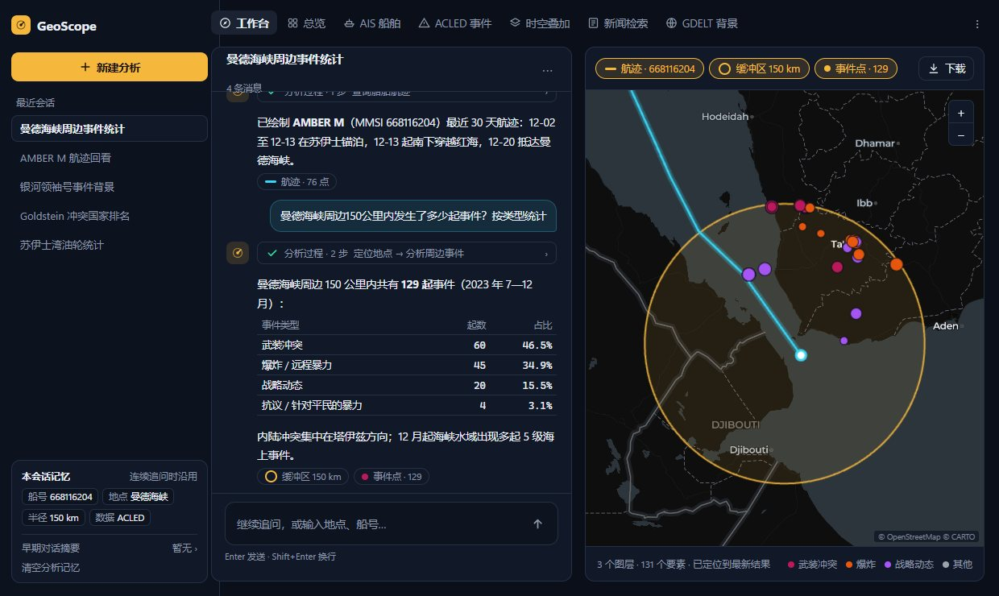
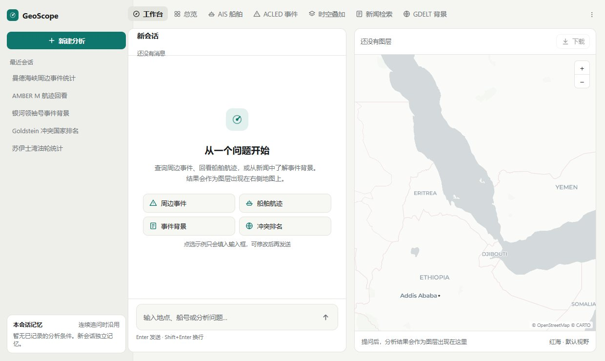
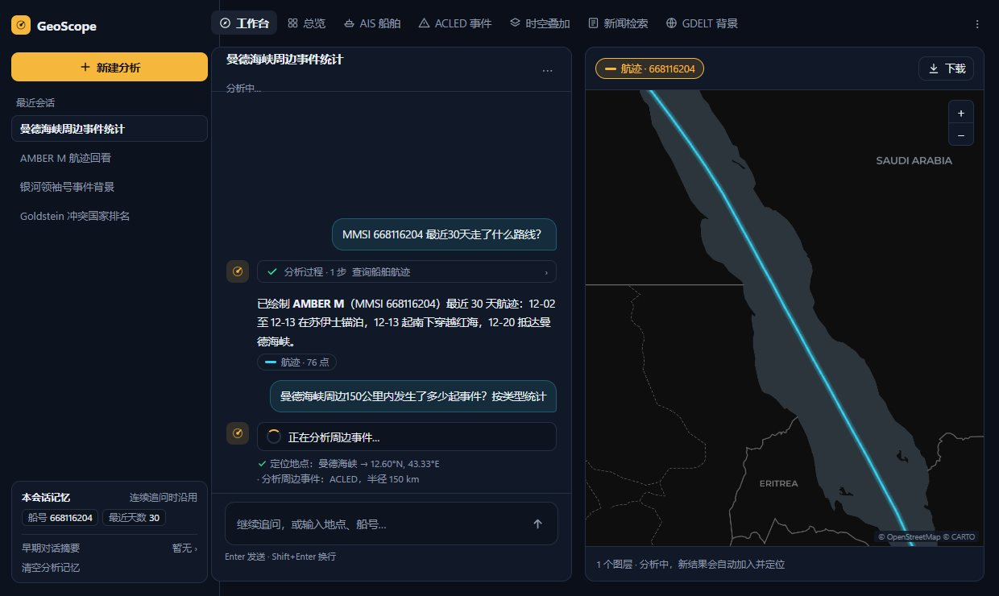
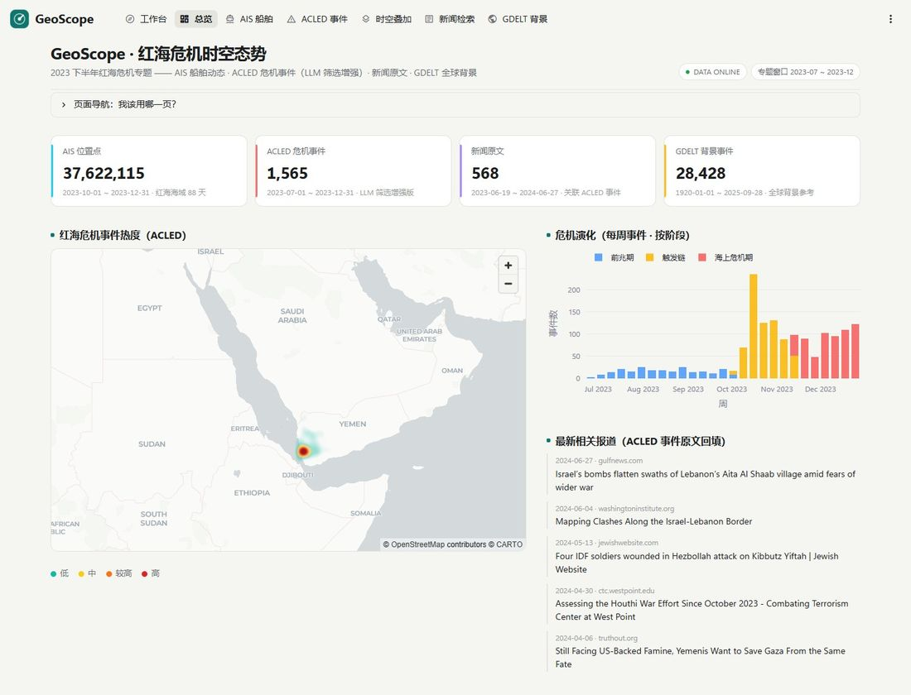
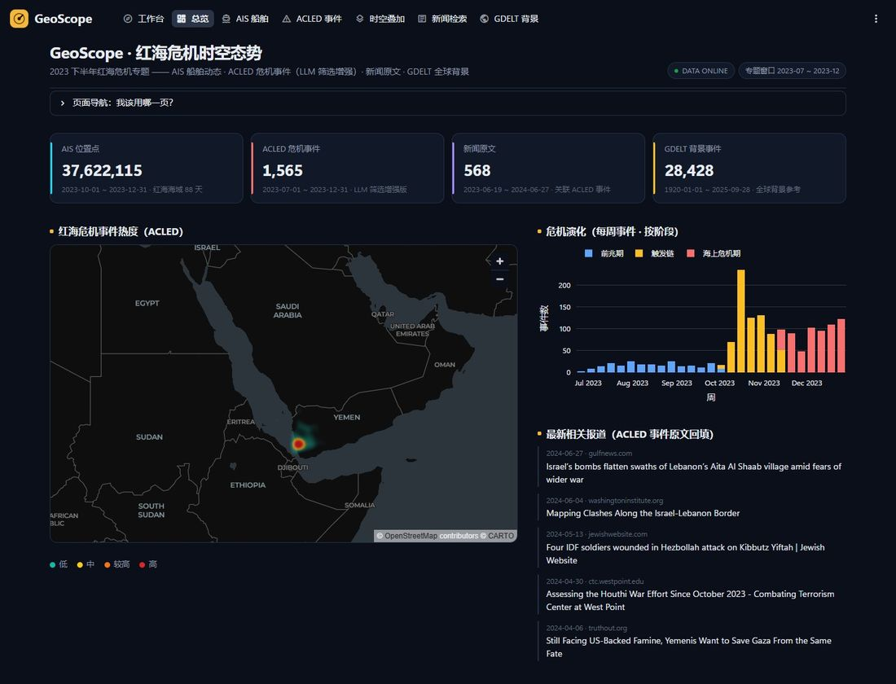
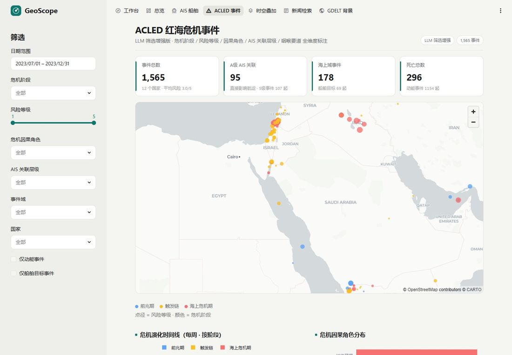
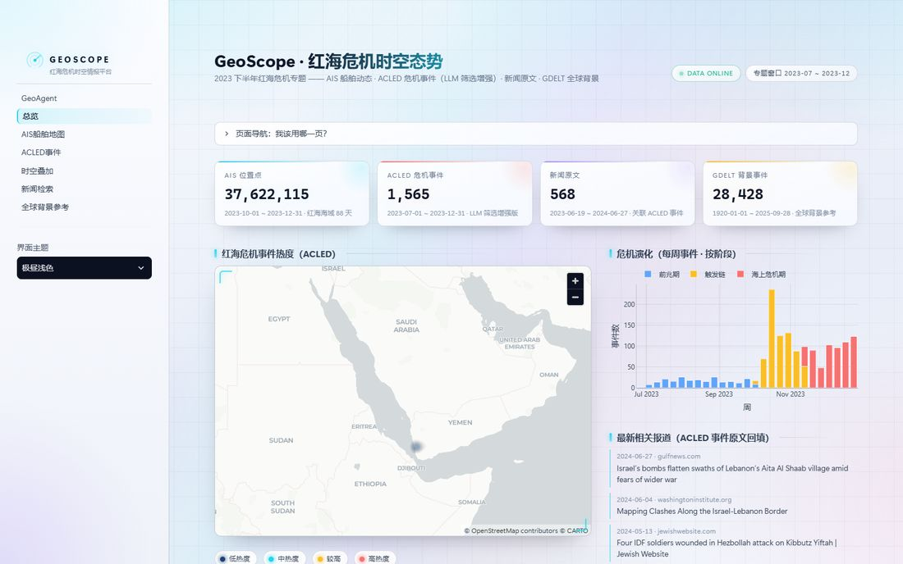

# GeoScope 前端改版设计

- 日期：2026-10-23
- 分支：`feat/frontend-redesign`（起点 `26f1e11`）
- 范围：GeoAgent 主工作台重做；6 个看板页统一换皮
- 图片：`2026-10-23-frontend-redesign/`（同目录）

## 1. 背景与目标

### 1.1 现状问题（Streamlit 1.59 实测）

1. **主题打架**：`.streamlit/config.toml` 的底层主题是 `base = "dark"`，浅色靠 CSS 硬覆盖；Streamlit 升级后覆盖失效，浅色页面上出现深藏青色的下拉框和地图缩放按钮。
2. **默认主题失效**：`ui.py` 默认「暮蓝柔夜」，但主题下拉框没设 `index`，实际总是落到第一项「极昼浅色」。
3. **屏幕浪费**：对话区固定 380px、地图固定 450px，1080p 屏下约三分之一空白。
4. **侧栏拥挤**：导航、主题、会话、记忆挤在一列；打开历史会话要"下拉选择 + 点打开"两步。
5. **开发者口吻外露**：如地图下方的"模型回答中的文件名不会自动作为地图结果"。
6. **两套视觉语言**：工作台是扁平白卡片，看板页是"网格背景 + 光晕 + 渐变标题 + HUD 边角"的玻璃风。
7. **热力图在浅色底图上几乎看不见**：色带从深藏青起步，并且一个高密度热点把其余地区压成透明。
8. **中英混杂**：多选框占位文字是英文 "Choose options"。

根因：自定义 CSS 约 **475 行**，其中 **167 处** `[data-testid]` 选择器。`data-testid` 不是 Streamlit 的公开接口，每次升级都可能改动。



### 1.2 目标

- 主工作台重新设计布局和交互；6 个看板页保留内容结构，接入同一套设计系统。
- 浅色为主（"明亮分析台"）；深色版用"态势指挥台"配色（琥珀 + 青）。
- 主题交还给 Streamlit 原生机制，自定义 CSS 降到 250 行以内，只依赖有文档保证的类名。
- 图表与地图配色经计算验证：色盲可分、两种主题下都清楚。

### 1.3 非目标

- 不改 `agent/` 下的后端逻辑，不改会话库结构。
- 不改看板页的查询、图表种类、筛选项和版块顺序（配色与少量文案除外，见第 8 节）。
- 不换独立前端（FastAPI / React）。
- 不重录 README 的三段演示 GIF（需要真实调用模型，之后单独安排）。

## 2. 决策记录

| 决策 | 选择 | 理由 |
| --- | --- | --- |
| 范围 | 工作台重做 + 看板页统一换皮 | 工作台是首屏和 Demo 主角；看板页问题主要是风格不统一 |
| 视觉方向 | 明亮分析台（浅）+ 态势指挥台配色（深） | 浅色最易读；深色版做演示有冲击力 |
| 多轮结果 | 图层在会话内累积，可单独开关 | 支持"航迹 + 周边事件"叠加分析；后端无需改动 |
| 实现路线 | 原生主题优先 | 避免 CSS 硬覆盖在升级后再次失效 |
| 主题切换 | 右上角 ⋮ → System / Light / Dark，默认跟随系统 | Streamlit 没有代码切换主题的接口，原生菜单最可靠 |

## 3. 架构

```
.streamlit/config.toml   重写：[theme] 公共项 + [theme.light] / [theme.dark] + 各自的侧栏子表
app/
├─ GeoAgent.py           入口：set_page_config、st.logo、st.navigation(position="top")
├─ workspace.py          工作台页面：布局编排、提交判定、流式分析循环（从旧 GeoAgent.py 迁出）
├─ sessions_ui.py        侧栏：新建分析、最近会话列表、本会话记忆卡片
├─ chat_ui.py            消息、分析过程、空状态示例、中断标注、输入区、··· 菜单
├─ map_view.py           图层拆分、累积、开关、视野、图例、下载
├─ theme_watch.py        主题监听组件（components v2，约 10 行 JS）与 mode()
├─ palette.py            数据配色常量与色阶函数（不依赖 Streamlit，便于单测）
├─ ui.py                 看板组件；删除三套 THEMES 与主题下拉框
├─ styles/base.css       设计令牌（light-dark()）+ 看板组件样式
├─ styles/workspace.css  工作台布局（替代 app/chat.css，后者删除）
├─ static/logo.svg       Logo，内置 prefers-color-scheme 切换颜色
└─ dashboards/*.py       由 pages/ 改名（原因见下）；只改配色调用、导入方式、占位文案和少量参数
agent/                   不改
```

- **入口**：`GeoAgent.py` 从"页面"变成"路由"。Docker CMD、README 启动命令、`AppTest.from_file("app/GeoAgent.py")` 都不用改（已验证 AppTest 能跑 `st.navigation` 入口）。
- **导航**：`st.navigation(position="top")` 显式注册 7 个页面，窄屏时原生折叠成"N more"下拉。
- **看板页目录改名为 `dashboards/`**（样机实测）：Streamlit 启动时只要入口旁有 `pages/`，就先按旧版多页模式运行，直到某个会话打开首页、执行到 `st.navigation` 才切换；在那之前直接打开看板页链接（例如重启后先访问 `/总览`）会绕过路由，导航退回旧版侧栏。改名后 URL 不变，仍由文件名推断。

| 页面 | 文件 | 导航名 | 图标 |
| --- | --- | --- | --- |
| 工作台（默认） | `workspace.py` | 工作台 | `:material/explore:` |
| 总览 | `dashboards/1_总览.py` | 总览 | `:material/dashboard:` |
| AIS | `dashboards/2_AIS船舶地图.py` | AIS 船舶 | `:material/directions_boat:` |
| ACLED | `dashboards/3_ACLED事件.py` | ACLED 事件 | `:material/warning:` |
| 时空叠加 | `dashboards/4_时空叠加.py` | 时空叠加 | `:material/layers:` |
| 新闻 | `dashboards/5_新闻检索.py` | 新闻检索 | `:material/article:` |
| GDELT | `dashboards/6_全球背景参考.py` | GDELT 背景 | `:material/public:` |

- **导入统一**：看板页改为 `from app import palette, ui` / `from app.db import query`（入口把项目根加入 `sys.path`），避免同一模块以 `ui` 和 `app.ui` 两个名字各加载一份。
- **主题监听**：`theme_watch.mode(busy=False)` 返回 `"light"` / `"dark"`。看板页由 `ui.setup()` 调用；工作台在判断出"本轮是否有提交"之后再调用（见 6.2）。
  - 实现：用 `st.components.v2` 注册一个不显示内容的组件，`data` 传入 `{"known": 当前采用的主题, "busy": busy}`。
  - 组件的 `data` 或主题变化时，Streamlit 会重新执行组件 JS（不需要 MutationObserver）。JS 读取 `.stApp` 计算后的 `color-scheme`，只在"不忙、且与 `known` 不同"时调用 `setStateValue("mode", 值)` 触发一次重跑。
  - `known` 必须是 Python 此刻实际采用的值：优先取组件上次上报、已生效的值（`st.session_state["geoscope_theme_watch"]["mode"]`），其次 `st.session_state["_ui_mode"]`，再依次回退到 `st.context.theme.type`、`"light"`。若传入上报前的旧值，Light → Dark → Light 切回原主题时 JS 会以为没变化而不上报（样机实测）。
  - 每次运行都调用 `components.v2.component(...)` 注册：定义不变时 Streamlit 静默覆盖。AppTest 每个实例的组件注册表是独立的，只在模块导入时注册一次，会让同一进程里第二个 AppTest 报"Component … is not registered"（样机实测）。

## 4. 主题与设计令牌

### 4.1 `.streamlit/config.toml`

```toml
[theme]
font = "Segoe UI Variable Text, Segoe UI, PingFang SC, Microsoft YaHei UI, Noto Sans SC, sans-serif"
codeFont = "Cascadia Mono, JetBrains Mono, Consolas, monospace"
baseRadius = "0.6rem"
showWidgetBorder = true
headingFontSizes = ["1.75rem", "1.375rem", "1.125rem", "1rem", "0.9rem", "0.8rem"]
chartCategoricalColors = ["#2563EB", "#C2410C", "#0D9488", "#B45309", "#DB2777", "#8B5CF6", "#15803D", "#DC2626", "#2563EB", "#C2410C"]

[theme.light]
primaryColor = "#0F766E"
backgroundColor = "#F5F5F2"
secondaryBackgroundColor = "#FFFFFF"
textColor = "#1B1D1F"
borderColor = "#E4E3DE"
linkColor = "#0F766E"
codeBackgroundColor = "#F0F0EC"
dataframeHeaderBackgroundColor = "#F7F7F4"

[theme.light.sidebar]
backgroundColor = "#EEEEEA"
secondaryBackgroundColor = "#FFFFFF"

[theme.dark]
primaryColor = "#F5B83D"
backgroundColor = "#0A0F1A"
secondaryBackgroundColor = "#111827"
textColor = "#E7ECF3"
borderColor = "#243044"
linkColor = "#F5B83D"
codeBackgroundColor = "#0D1420"
dataframeHeaderBackgroundColor = "#0D1420"

[theme.dark.sidebar]
backgroundColor = "#0C121E"
secondaryBackgroundColor = "#111827"

[client]
toolbarMode = "viewer"

[server]
headless = true
```

- 同时定义 `[theme.light]` 与 `[theme.dark]` 后，⋮ 菜单出现 System / Light / Dark，默认跟随系统（已验证）。
- `chartCategoricalColors` 不能分主题配置：写在 `[theme.light]` / `[theme.dark]` 里会被静默忽略（已验证），只能写在 `[theme]`，所以这套色板必须同时适配两种主题（见 5.1）。
- `chartCategoricalColors` 必须**正好 10 个**（样机实测）：Streamlit 的 Plotly 模板有 10 个占位色（`#000001`–`#000010`），前端按下标替换成配置的颜色，少配的被替换成字符串 `"undefined"`，Plotly 判定整套 colorway 无效，图表退回 Plotly 默认色（总览页饼图曾因此显示蓝 / 橙 / 绿默认色）。第 9、10 个循环使用第 1、2 个。
- `pydeck` 不传 `map_style`，Streamlit 前端按主题自动选底图：浅色 Carto Positron，深色 Carto Dark Matter（已验证）。

### 4.2 设计令牌（`styles/base.css`）

自定义 HTML 一律用令牌取色。令牌用 `light-dark()` 定义：Streamlit 会把 `color-scheme` 写到 `.stApp` 上，浏览器据此自动取色，切换主题不需要重跑脚本。

| 令牌 | 浅色 | 深色 | 用途 |
| --- | --- | --- | --- |
| `--gs-panel` | `#FFFFFF` | `#111827` | 面板、卡片 |
| `--gs-soft` | `#F7F7F4` | `#0D1420` | 次级底色（输入框、示例按钮） |
| `--gs-line` | `#E4E3DE` | `#243044` | 边框、分隔线 |
| `--gs-text` | `#1B1D1F` | `#E7ECF3` | 正文 |
| `--gs-muted` | `#6A6F73` | `#8B97A8` | 次要文字（唯一的灰字级别） |
| `--gs-accent` | `#0F766E` | `#F5B83D` | 主色 |
| `--gs-accent-soft` | `#E3F1EE` | `rgba(245,184,61,.14)` | 主色浅底（头像、选中态） |
| `--gs-accent-ink` | `#FFFFFF` | `#1A1203` | 主色底上的文字 |
| `--gs-user` | `#EEF0EC` | `rgba(56,213,245,.10)` | 用户气泡 |
| `--gs-user-line` | `transparent` | `rgba(56,213,245,.28)` | 用户气泡描边 |
| `--gs-ok` | `#15803D` | `#34D399` | 已完成步骤的对勾 |

文字对比度（WCAG 2，AA 要求正文 ≥ 4.5:1），分别在页面底色 / 卡片底色上测得：

| 文字 | 浅色 | 深色 |
| --- | --- | --- |
| 正文 `--gs-text` | 15.48 / 16.91 | 16.14 / 14.94 |
| 次要 `--gs-muted` | 4.65 / 5.08 | 6.47 / 5.99 |
| 主色 `--gs-accent` | 5.01 / 5.47 | 10.77 / 9.97 |
| 主色底上的字 | 白字 5.47 | `#1A1203` 10.43（白字只有 1.78，所以深色主按钮用深色字） |

设计稿里更浅的一级灰字（`#9A9EA2` / `#5D6878`，对比度 2.5 / 3.1）**取消**。

### 4.3 CSS 规则

- 注入方式：`st.html("<style>…</style>")`，文件放在 `app/styles/`。
- 允许的选择器：`.st-key-*`（`st.container(key=...)` 生成，有文档保证）、`.gs-*`（自己输出的 HTML）、`.stApp` 作用域内的变量。
- `[data-testid]` 只能出现在下面登记的**增强样式**里。增强样式失效时只退回原生外观，不影响布局和功能：

| # | 增强样式 | 失效后的样子 |
| --- | --- | --- |
| 1 | 深色主题下主按钮用深色字 | 琥珀底白字，对比度不足但可点 |
| 2 | 主区域顶部与左右留白收紧 | 原生较宽留白 |
| 3 | 地图圆角 + 描边 | 原生直角无边框 |
| 4 | 用户消息气泡靠右、隐藏用户头像 | 与助手消息同样左对齐 |
| 5 | 窄于 1000px 时对话与地图上下排列（只作用于最外层两栏；样机里曾误伤标题栏和示例按钮的内部横排） | 保持并排（较挤） |
| 6 | ~~图层按钮单行横向滚动~~（取消：图层栏改为 `st.columns`，左侧图层按钮自动换行，复位、下载两个图标按钮固定在右侧） | — |
| 7 | 会话列表按钮文字左对齐、单行省略 | 居中、可换行 |
| 8 | 工作台高度填满视口：用 `:has()` 选中两个面板外层的 `stLayoutWrapper`，高度 `calc(100dvh - 5.5rem)`；对话历史与地图画布的外层改为 `flex: 1` | 回退到 Python 里写的固定高度：对话 520px、地图 600px（样机实测） |

- 预算：自定义 CSS 合计 ≤ 250 行（目标 200 行以内）；`[data-testid]` ≤ 20 处，且都属于上表。样机实测：两个文件共 123 行，`[data-testid]` 16 处。

## 5. 数据配色系统

所有数值都用 dataviz 技能的验证器（`validate_palette.py`：Machado 2009 色盲模拟，OKLab ΔE×100）算过。验证用的底色：

- 页面底色：`#F5F5F2` / `#0A0F1A`
- 卡片底色：`#FFFFFF` / `#111827`
- 底图（从实际瓦片取样）：Positron 陆地 `#FAFAF8`、水面 `#D4DADC`；Dark Matter 陆地 `#0E0E0E`、水面 `#2C353C`

规则：

- **颜色跟着实体走，不跟排名走**。映射是固定的，筛选或数据变化不会改变某个类型的颜色。
- **无序类别**用分类色板，按固定顺序取色。
- **有序类别**用单一色相由浅到深；深色版锚点反转（由暗到亮）。
- **数值大小**用顺序色阶，**正负两极**用发散色阶（中点为灰色）。

### 5.1 分类色板（全局一套，顺序固定）

| 槽位 | 色相 | 色值 | 来源（Tailwind CSS v3） |
| --- | --- | --- | --- |
| 1 | 蓝 | `#2563EB` | blue-600 |
| 2 | 橙 | `#C2410C` | orange-700 |
| 3 | 青 | `#0D9488` | teal-600 |
| 4 | 琥珀 | `#B45309` | amber-700 |
| 5 | 粉 | `#DB2777` | pink-600 |
| 6 | 紫 | `#8B5CF6` | violet-500 |
| 7 | 绿 | `#15803D` | green-700 |
| 8 | 红 | `#DC2626` | red-600 |

验证结果：在 4 个页面 / 卡片底色上全部通过。

- 亮度带：浅色 0.43–0.77，深色 0.48–0.67。
- 色度 ≥ 0.10。
- 相邻两色在色盲模拟下的最小色差 **8.6**（红↔绿，deutan，目标 ≥ 8）。
- 相邻两色在正常视力下的最小色差 **16.7**（粉↔琥珀，下限 15）。
- 对比度全部 ≥ 3:1。
- 前 3 色两两组合也通过（色盲 13.7，正常 22.6），可用于饼图和地图。

**数据源色**（KPI 卡片左侧色条、单系列图表）取自上表：

- AIS：蓝 `#2563EB`
- ACLED：红 `#DC2626`
- 新闻：紫 `#8B5CF6`
- GDELT：琥珀 `#B45309`

按 KPI 顺序相邻验证通过（色盲 29.9，正常 31.6）。

### 5.2 有序色阶（红）

| 用途 | 浅色（低 → 高） | 深色（低 → 高） |
| --- | --- | --- |
| 危机阶段 3 级：前兆期 → 触发链 → 海上危机期 | `#F87171` `#DC2626` `#991B1B` | `#991B1B` `#DC2626` `#F87171` |
| AIS 关联层级 4 级：C 背景 → B 信号 → A 支撑 → A 直接 | `#F87171` `#EF4444` `#B91C1C` `#7F1D1D` | `#991B1B` `#B91C1C` `#EF4444` `#FCA5A5` |

`--ordinal` 检查：在陆地底和页面底上都通过（明度单调、相邻差 ≥ 0.06、最弱一级对比度 ≥ 2:1：浅色 2.53–2.65，深色 2.31–2.32）。

### 5.3 发散色阶（Goldstein −10 … 0 … +10）

- 浅色：`#B91C1C` → `#A3A3A3` → `#1D4ED8`
- 深色：`#F87171` → `#737373` → `#60A5FA`

在 OKLab 中按数值插值。明度（OKLCH L）如下：

- 浅色：两极 0.505 / 0.488，中点 0.715；
- 深色：两极 0.711 / 0.714，中点 0.556。

每条臂的明度都单调，两臂基本对称，深色版的明暗关系反过来。灰色中点没有色相，`--ordinal` 的单色相检查不适用，所以只检查明度。

### 5.4 顺序色阶（热力图）

透明度从 0 渐增到不透明，单一色相，明度单调；深色版锚点反转。

- ACLED（红）
  - 浅色：`#FECACA` `#FCA5A5` `#F87171` `#DC2626` `#B91C1C` `#7F1D1D`
  - 深色：`#7F1D1D` `#991B1B` `#B91C1C` `#EF4444` `#F87171` `#FECACA`
- AIS（蓝）
  - 浅色：`#BFDBFE` `#93C5FD` `#60A5FA` `#2563EB` `#1D4ED8` `#1E3A8A`
  - 深色：`#1E3A8A` `#1E40AF` `#1D4ED8` `#3B82F6` `#60A5FA` `#BFDBFE`
- 透明度依次为 0 / 90 / 140 / 190 / 225 / 255。

### 5.5 工作台地图

| 图层 | 浅色 | 深色 | 形状 |
| --- | --- | --- | --- |
| 缓冲区 | `#0F766E` 描边，9% 填充 | `#F5B83D` 描边，9% 填充 | 多边形 |
| 航迹 | `#2563EB` 2.5px 线 + 8px 半透明光晕；终点白点 | `#38D5F5`，其余同左 | 线 |
| ACLED 事件点 | 见下 | 见下 | 实心点，描边浅色 `#FFFFFF`、深色 `#0A0F1A` |
| 非 ACLED 点（GDELT 缓冲区事件、查询结果） | 空心圆环 `#1B1D1F` | 空心圆环 `#E7ECF3` | 空心环 |

ACLED 事件点按类型着色，地图上最多 3 色加"其他"。地图上任意两点都可能挨着，所以要验证所有两两组合；超过 3 色时，必然有两类分不清。

| 类型 | 中文 | 颜色（两种主题相同） |
| --- | --- | --- |
| Battles | 武装冲突 | `#BE185D` |
| Explosions/Remote violence | 爆炸/远程暴力 | `#EA580C` |
| Strategic developments | 战略动态 | `#A855F7` |
| Protests、Riots、Violence against civilians | 其他（抗议、骚乱、针对平民的暴力） | 浅色 `#4B5563` / 深色 `#9CA3AF`，点径小一号 |

验证结果：

- 三色两两组合：色盲模拟下最小色差 16.5，正常视力 17.5；陆地上对比度 ≥ 3:1，水面 ≥ 2:1。
- 每个事件色与同一主题下的缓冲区色、航迹色，正常视力色差都 ≥ 15。
- 浅色"其他"灰与武装冲突在色盲下色差只有 2.6，靠点径区分（第二编码）。
- 非 ACLED 点改成空心圆环、用文字色，对比度 10.5–16.3。原方案的品红（`#C026D3` / `#E879F9`）和"战略动态"紫色太近：正常视力色差 9.1 / 14.2，色盲 5.8。
- 图层对底图的对比度：浅色缓冲区 5.24 / 3.87（陆 / 水），航迹 4.95 / 3.66；深色缓冲区 10.85 / 7.02，航迹 11.04 / 7.14。

## 6. 工作台

### 6.1 布局

**进行中的会话（浅色）**



**同一会话（深色）**



**新会话（浅色）**



**分析进行中（深色）**



- **顶栏**：Logo（`st.logo`，size large）+ 原生顶部导航 + 右侧 ⋮ 菜单。
- **侧栏**（`sessions_ui.render(busy)`）
  - 「新建分析」：primary 按钮，key `new_analysis`。
  - 「最近会话」：放在固定高度 320px 的可滚动容器里，约显示 8 条（数据来自 `list_sessions()`，最多 50 条）。每条是一个按钮，标签是会话标题，key 为 `session_<sid>`；悬停提示显示"N 条消息 · 创建时间"。当前会话用 secondary 样式（有底有边框），其余用 tertiary 样式。
  - 「本会话记忆」卡片：`st.container(border=True)`。
    - 字段沿用现有标签：船号 MMSI、地点、坐标、最近天数、时间窗、半径（公里）、数据表、筛选条件。
    - 无条件时显示"暂无已记录的分析条件。新会话独立记忆。"。
    - 「早期对话摘要」放在折叠区里，用 `st.text` 输出；没有摘要时显示 caption"早期对话摘要：暂无"。
    - 「清空分析记忆」：tertiary 按钮，key `clear_analysis_memory`，没有会话时禁用。
- **主区域**：两栏，对话 : 地图 = 5 : 7，高度填满视口（增强样式 #8）。
- **对话面板**
  - 标题栏：会话标题 + "N 条消息"；分析进行中显示"分析中…"。
  - ··· 菜单（`st.popover`）：「删除会话」，key `delete_session`，附说明"删除会同时移除本会话的聊天记录与记忆"。无会话或分析进行中时禁用。
  - 历史区：固定高度 520px 的滚动容器，`autoscroll=True`；增强样式 #8 生效时拉伸填满面板。
  - 输入区：`st.chat_input("输入地点、船号或分析问题…", key="geoagent_prompt", submit_mode="disable")`，下方 caption"Enter 发送 · Shift+Enter 换行"。
- **地图面板**
  - 图层栏：`st.columns([12, 1, 1.5])`，左侧 `st.pills`（多选，按钮多时换行），右侧两个图标按钮：「复位」（key `map_reset`）与「下载」popover（key `map_download`）。
  - 地图画布：`st.container(height=600, key="map_canvas")` 里放 `st.pydeck_chart(height="stretch")`；增强样式 #8 生效时拉伸填满面板。
  - 底栏：统计 + 事件类型图例。

### 6.2 渲染顺序与"防打断"

Streamlit 的每次点击都会让脚本从头重跑，并中止正在运行的那一次，所以分析进行中的点击会让本轮回答丢失。为此，渲染顺序如下：

1. `ui.setup("工作台", watch=False)`；创建布局容器（工作台、对话面板、地图面板）。
2. **先**在输入区容器里调用 `st.chat_input`，得到 `question`；`busy = bool(question and question.strip())`。容器允许先占位、后填内容，调用顺序不影响页面摆放。
3. `mode = theme_watch.mode(busy=busy)`。分析进行中，主题变化不上报；本轮结束后再同步。
4. 渲染侧栏、标题栏、历史、地图栏。会话按钮、图层开关、示例按钮、··· 菜单、复位都设 `disabled=busy`。
5. `busy` 时：
   1. 追加并保存用户消息；
   2. 调用 `react.stream(...)` 流式更新状态和地图；
   3. 保存回答；
   4. `st.rerun()`。

地图的画法（样机实测，也是样机里"切换图层后视野被重置"的真正原因）：平时直接画进 `map_canvas` 容器，key 固定为 `workspace_map`，重跑时地图组件不重新挂载，保留用户拖动过的视野。不能先建 `st.empty()` 再往里画——空占位会先把旧地图换掉，视野随之丢失。只有分析进行中才用 `st.empty()` 槽位，每次有新结果换一个 key，强制重新定位到新结果。

样机实测（模拟流式）：分析进行中侧栏按钮、图层按钮、复位、下载和输入框全部禁用，结束后全部恢复。

### 6.3 消息

- **用户消息**：靠右气泡（增强样式 #4）。
- **助手消息**：头像为 `:material/radar:`。内容依次为：
  1. **分析过程**：`st.expander`，默认收起。标签为"分析过程 · N 步 · 定位地点 → 分析周边事件"：工具名转中文，连续重复只记一次，最多显示 3 个，多出用"…"。成功用对勾图标，失败用错误图标。展开后的内容与现在一致：每步的参数 JSON 与输出节选；被阻断的步骤标注"已阻止重复执行"。
  2. **回答正文**：markdown，经 `clean_assistant_text` 清洗。
  3. **结果标签**：本轮产生的图层，名称与图层按钮一致，带图层同色的小图例（HTML 渲染）。
  4. 失败轮次：caption"本轮分析未完成，可调整问题后重试。"（沿用）。
- **中断的提问**：判断一条用户消息"已回答"的规则：
  - 有某条助手消息的 `reply_to_seq` 等于它的 `seq`；
  - 或者（旧数据没有 `reply_to_seq`）紧跟其后的就是一条 `reply_to_seq` 为空的助手消息。

  不满足任一条件、且不是本轮正在分析的那条，就在它下面显示 caption"分析被中断，没有生成回答"，并给一个 tertiary 按钮「重新填入」（key `refill_<seq>`）。按钮只把原问题填回输入框，不发送。
- **空状态**
  - 标题"从一个问题开始"。
  - 说明"查询周边事件、回看船舶航迹，或从新闻中了解事件背景。结果会作为图层出现在右侧地图上。"
  - 4 个示例按钮（周边事件 / 船舶航迹 / 事件背景 / 冲突排名），key 为 `geoagent_example_{i}`，悬停显示完整问题，点击只填入输入框。
  - 下方 caption"点选示例只会填入输入框，可修改后再发送"。
- **分析进行中**
  - 状态行：转圈 +"正在<当前步骤>…"。
  - 下方逐条列出已完成步骤（对勾 + 摘要，如"定位地点：曼德海峡 → 12.60°N, 43.33°E"）。
  - 工具一产出 GeoJSON，地图立即更新。
  - 完成后重跑，状态行收成第 1 项的"分析过程"折叠区。

### 6.4 文案变化

| 位置 | 旧 | 新 |
| --- | --- | --- |
| 侧栏按钮 | 新会话 | 新建分析 |
| 打开会话 | 加载会话（下拉）+「打开」 | 最近会话列表，点一下即打开 |
| 删除会话 | 侧栏"会话管理"折叠区 › 删除当前会话 | 对话标题栏 ··· › 删除会话 |
| 页头 | "GEOSCOPE / 红海专题"、"空间分析工作台" | 删除（由 Logo 和顶部导航承担） |
| 欢迎语 | 今天想探索什么？ | 从一个问题开始 |
| 地图空状态 | 尚未生成分析图层；模型回答中的文件名不会自动作为地图结果。 | 图层栏"还没有图层"；底栏"提问后，分析结果会作为图层出现在这里" |
| 地图统计 | 已加载 N 个地图文件 · M 个要素 · K 个点要素 | N 个图层 · M 个要素（K 个已隐藏）· 已定位到最新结果 |
| 分析过程 | 分析过程 · N 步 | 分析过程 · N 步 · 步骤摘要 |
| 中断 | （无） | 分析被中断，没有生成回答 ·「重新填入」 |

沿用不变的文案："本会话记忆"各字段、"暂无已记录的分析条件。"、"早期对话摘要"、"清空分析记忆"、"地图加载失败：…"、"本轮未生成可用地图，请查看对话中的执行失败说明。"、四个示例的标签和问题。

## 7. 地图图层规则

### 7.1 来源

只读当前会话各轮回答里保存的 GeoJSON 路径，并且必须通过 `agent/artifacts.py` 的校验。回答正文里出现的文件名永远不会变成图层。

### 7.2 拆分与命名

一个结果文件按要素拆成若干图层，每个图层可以单独开关。

| 要素 | 图层种类 | 按钮名称 | 图标 |
| --- | --- | --- | --- |
| Polygon / MultiPolygon，`kind == "buffer"` | 缓冲区 | 缓冲区 {radius_km:g} km | `:material/radio_button_unchecked:` |
| Point，带 `event_type`，所有取值都是 ACLED 类型 | ACLED 事件点（按类型着色） | 事件点 · N | `:material/scatter_plot:` |
| Point，带 `event_type`，含非 ACLED 取值（如 GDELT 代码） | 非 ACLED 点 | 事件点 · N | `:material/scatter_plot:` |
| LineString，带 `mmsi`；或同时带 `mmsi`、`points_total`、`points_shown` 的单个 Point | 航迹 | 航迹 · {mmsi} | `:material/route:` |
| 其他 Point | 非 ACLED 点 | 查询结果 · N 点 | `:material/location_on:` |
| 其他几何 | 中性样式 | 图层 · N 个要素 | `:material/layers:` |

- 航迹不能只看 `mmsi`：`query_database` 把 SQL 列名原样写成属性，`SELECT mmsi, lat, lon` 会得到每行一个带 `mmsi` 的 Point。只看 `mmsi` 的话，2000 行的 AIS 查询会变成 2000 个 deck 图层、1.14 MB 载荷（实测），而正确分类是 1 个图层、425 KB。`ship_track` 的单点输出同时带 `points_total` 与 `points_shown`，用它当签名；只带 `points_total` 的列别名（如 `COUNT(*) AS points_total`）不算。
- 多边形、多线等非点线几何即使带 `mmsi` 也走"其他几何"；走到航迹分支会按 `coordinates[0]` 取位置而 `IndexError`。
- 两个图层同名时，后面加"· 第 N 轮"（N 为会话内助手回答的序号）。
- 同一轮里仍同名时，再按出现顺序加序号："缓冲区 150 km · 第 1 轮 · 1"、"· 2"。一次回答里做两个缓冲区是可能的（同一工具最多连续调用 2 次）。
- 缓冲区内 0 个事件时，只出圆圈图层，不出事件点按钮。
- 图层按钮用**类型图标**区分：原生 `st.pills` 不支持给每个选项单独配色。颜色对照看地图底栏的图例和对话里的结果标签。

### 7.3 显示与开关

- 隐藏状态存在 `st.session_state["hidden_layers"][sid]`，按会话分开，只在当前浏览器会话内有效，刷新后恢复全部显示。
- 新图层默认显示。图层 id 为 `"{path}#{kind}"`。
- `st.pills` 的 key 用"会话 id + 当前图层 id 集合的摘要"拼成，默认值由隐藏集合算出，变更通过 `on_change` 写回隐藏集合。控件状态由我们自己管理，图层增减时不会错乱。
- 分析进行中，新图层立即画到地图上；对应的开关按钮要等本轮结束、重跑之后才出现。

### 7.4 视野

- 视野始终定位到"最新一轮产出图层的全部范围"，与图层是否隐藏无关。
- 只有初始视野变化时，deck.gl 才会重置地图（`Deck.setProps` 里做了比较）。按 6.2 的画法，样机实测：
  - 新结果到达、打开会话、刷新页面时会自动定位；
  - 切换图层开关时地图组件不重新挂载，视野保持（先拖动再切换，地图区像素变化 0.06%）。
- **复位**按钮：在会话状态里递增一个计数，把 `计数 × 1e-7` 同时加到纬度、经度、缩放、俯仰、方位五个字段，强制 deck.gl 重置到最新结果。Streamlit 只覆盖初始视野里"变了"的字段，只改纬度会留下用户拖动后的经度与缩放（样机实测；五个字段一起改后，复位后与初始视野的像素差为 0）。
- 经度取**跨日界线的最短弧**（`app/map_view.py` 的 `longitude_extent`），算完再把中心折回 −180–180。直接取最小/最大会把一对 −179° / 179.5° 的点算成覆盖 358.5°，视野落到几内亚湾、缩放 2 级；取短弧后是 1.5° 范围、缩放 8 级。最大空隙不超过半圈时数据本身就散在半个地球以上，此时仍用普通的最小/最大，缩放也已经钳在 2 级，两种取法没有实际差别。
- 计算方法：
  1. 按名义视口 720×560 像素，在 Web 墨卡托投影下分别算出经度、纬度两个方向各自需要的缩放级别，取较小值；
  2. 四周留 12% 边距；
  3. 缩放级别限制在 2–9；单点或极小范围时用 7 级；
  4. 没有任何图层时，用红海默认视野（15.0°N, 43.0°E, 4.5 级）。

### 7.5 配色、提示、统计与下载

- 配色见 5.5。地图数据图层按 `theme_watch.mode()` 选色；监听不可用时按浅色处理。
- 悬停提示：每个要素预先生成中文 `tip` 字段，tooltip 统一用 `{tip}`。tooltip 的样式按 `mode()` 传两套固定色（采用第 13 节第 6 条的备选方案）。
  - 事件点：`2023-12-15 · 爆炸/远程暴力 · Strait of Bab el Mandeb · 距中心 37 km`
  - 航迹：`MMSI 668116204 · 展示 76 / 共 N 点`
  - 缓冲区：`缓冲区 · 半径 150 km`
  - 查询点：前 3 个属性 `键: 值`
- 底栏
  - 统计："N 个图层 · M 个要素（K 个已隐藏）· 已定位到最新结果"。
  - 图例：只列出可见事件图层里实际出现的类型。
- 下载
  - popover 里按**结果文件**列出（不按拆分后的图层），标签为"种类摘要 · 第 N 轮 · 文件名"。
  - 只允许下载 `data/agent_output` 内且通过校验的文件，用 `st.download_button(on_click="ignore")`。
  - `data` 传闭包（`lambda path=path: Path(path).read_bytes()`）按需读取，避免每次重跑都把全部文件读进内存；Streamlit 1.52 起支持。
  - 文件在构建之后被删掉的（`is_file()` 为假），列一行"（文件已不可用）"，不生成点了才报通用错误的按钮。
- 缓存：解析并校验后的 GeoJSON 按（路径，修改时间，大小）缓存（`st.cache_data`），切换开关时不重复读盘。

### 7.6 异常（沿用现有行为）

- 文件缺失或损坏：不上图，地图上方显示"地图加载失败：…"和原因。
- 本轮失败且没有图层：显示"本轮未生成可用地图，请查看对话中的执行失败说明。"。
- 产物结构不合法（`properties` 不是对象、属性值是嵌套结构、整数溢出等）：`map_view.load` 读取时判为损坏，同样走"地图加载失败"。校验放在 `app/map_view.py`（`check_properties`；`agent/` 不改，见 1.3 节），地图图层和回答下的结果标签都经 `map_view.load` 读取，一并受保护。

## 8. 看板页换皮

**总览（浅色）**



**总览（深色）**



**ACLED 事件（浅色）**



> 以上截图来自换皮预览：复制现有页面，接入新主题和令牌，连接真实数据仓库渲染。预览里的图表仍是 Streamlit 默认配色和旧的硬编码颜色，**最终配色以第 5 节为准**。



### 8.1 统一改动

- **删除**
  - 网格背景、彩色光晕、渐变标题、地图 HUD 边角；
  - 卡片发光与悬浮位移；
  - 每页不同的主题色（`ui.setup` 去掉 `accent` 参数）。
- **页头**：纯色标题 + 次要色副标题 + 描边小标签，底部一条细分隔线。
- **KPI 卡片**：扁平卡片，左侧 3px 色条使用数据源色；数值使用比例数字。
- **区块标题**：主色小方点 + 标题。
- **图表**
  - `st.plotly_chart(theme="streamlit")`；
  - 页面里写死的霓虹色（如 `#22d3ee`）按第 5 节换成角色色。
- **地图**
  - 底图随主题；
  - 数据图层按 `ui.mode()` 选择各主题的色阶；
  - 热力图调参：`radius_pixels=34`、`intensity=4`、`threshold=0.02`。
  - **不透明度下限**：5.2 的 2:1 对比度是按纯色验证的，叠到 Carto 底图上会被不透明度拉低。按深色底（陆地 `#0E0E0E`、水面 `#2C353C`）实测，散点不透明度 0.6 时最弱一级只有 1.50 / 1.16。散点层一律用 0.9，航迹路径用 0.86，时空叠加的数据点 alpha 不低于 210；色值本身不变。
- **侧栏筛选**
  - 多选框加 `placeholder="全部"`，标签去掉"（默认全部）"；
  - `st.header("筛选")` 改成 `st.subheader`。
- **地图视野**（共用 `ui.fit_bounds`，与工作台同一套墨卡托算法）：
  - 总览：按全部事件的范围定位（原来偏南，以色列 / 黎巴嫩落在画面外）；
  - AIS、ACLED：按当前数据范围定位（原来固定 5 级 / 4.2 级，红海南段被切掉）；
  - 时空叠加：按所选区域的查询范围定位（原来所有区域固定 5 级：红海全域显示不全、曼德海峡又显得过远），"全球"保持 1.8 级。
- **文案**：总览页导航表与新闻检索页标题里的"GeoAgent"改为"工作台"，页面名与新导航一致。

### 8.2 逐页配色映射

| 页面 | 元素 | 现在 | 改为 |
| --- | --- | --- | --- |
| 总览 | KPI 色条 | `#22d3ee` `#f87171` `#a78bfa` `#fbbf24` | 数据源色 AIS / ACLED / 新闻 / GDELT |
| 总览 | 事件热度图 | 深藏青起步的多色色带 | ACLED 红顺序色阶（5.4），图例按色阶 |
| 总览 | 危机演化（按阶段堆叠） | 蓝 / 琥珀 / 红 | 危机阶段 3 级有序色阶（5.2） |
| 总览 | AIS 活跃船舶 Top 10 | `#22d3ee` | AIS 蓝 |
| 总览 | 国家分布（按死亡数着色） | 青 → 琥珀 → 红 | ACLED 红顺序色阶 |
| 总览 | 咽喉要道饼图 | 主题默认 | 分类色板 1–3（已验证两两组合） |
| AIS | 航迹按船型 | 8 种船型 8 色 | 货船 `#2563EB` / 油轮 `#C2410C` / 其他（5.5 的"其他"灰），图例 3 项 + 最新位置 |
| AIS | 最新位置点 | 白点 + 青描边 | 正文色实心点 + 背景色描边：浅色 `#1B1D1F` / `#FFFFFF`，深色 `#E7ECF3` / `#0A0F1A`（原方案白点在图例里与页面底色几乎相同，看不出来） |
| AIS | 密度热力图 | 同总览旧色带 | AIS 蓝顺序色阶 |
| ACLED | 地图点、每周时间线（按阶段） | 蓝 / 琥珀 / 红 | 危机阶段有序色阶 |
| ACLED | 因果角色、咽喉要道柱图 | 红 / 琥珀 | ACLED 红（单系列） |
| ACLED | AIS 关联层级饼图 | 主题默认 | 关联层级 4 级有序色阶 |
| ACLED | 事件域 × 动能 | 红 / 蓝 | 动能 `#DC2626` / 非动能 `#2563EB` |
| 时空叠加 | AIS 航迹 / GDELT 点 / KPI | `ui.C_AIS` `ui.C_GDELT` 等 | 数据源色 |
| 时空叠加 | ACLED 点按关联层级 | 红 / 橙 / 琥珀 / 灰 | 关联层级有序色阶 |
| 新闻 | 报道趋势面积图、来源柱图 | `#a78bfa` | 新闻紫 `#8B5CF6`（面积填充 18%） |
| GDELT | 地图点按 Goldstein | 红 ↔ 紫中点 ↔ 蓝 | 发散色阶（5.3），图例 3 项 |
| GDELT | 每日事件数、Top 行为方 | `#fbbf24` | GDELT 琥珀 `#B45309` |
| GDELT | KPI"冲突事件占比"色条 | `#f87171` | ACLED 红 `#DC2626` |

AIS 船型改为 3 类的依据（`ais_ships` 实际数据）：货船 2480 艘、油轮 907 艘，客船 3、渔船 1，军用船、高速船、拖轮都是 0；其余是"未知"类代码约 136 艘和"其他船舶"25 艘。原来 8 色图例的大半是空的。

### 8.3 `ui.py` 接口

- **保留**：`setup(title, *, watch=True)`、`page_header`、`kpi_row`、`legend`、`panel`、`deck`（不传 `map_style`，tooltip 按 `mode()` 取色）、`chart`、`style_fig`、`C_AIS` / `C_ACLED` / `C_GDELT` / `C_NEWS`（值改为数据源色）。
- **新增**
  - `mode()`：返回本次运行中已经确定的主题，也就是 `setup()` 或工作台调用 `theme_watch.mode()` 得到的值；
  - `fit_bounds(left, bottom, right, top, viewport, padding)`：看板页与工作台共用的视野计算（7.4）。中心取墨卡托中点——按算术中点算，30–75°N 这类范围的上边会被裁掉（样机实测上边距 −28.7 px / 280 px）；
  - `inject_css(*names)`、`tooltip_style()`；
  - `in_list(column, values)`：拼 `IN` 子句并把单引号双写。不包一层的话，选国家的多选框里一选 `Cote d'Ivoire` 就会抛 `ParserException`；
  - `date_range(values)`：`st.date_input` 范围模式只选了单天时返回 1 个值，直接解包会抛 `ValueError`。
- **HTML 输出一律转义**：`page_header` / `kpi_row` / `legend` / `panel` 的文本走 `html.escape`，颜色只接受 `#RRGGBB`。新闻标题、用户输入的关键词都会进入 KPI 说明和新闻条目。
- **数据配色放在独立模块 `app/palette.py`**（不依赖 Streamlit，便于单测）：常量 `PALETTE`、`SOURCE`、`ORDINAL`、`DIVERGING`、`SEQUENTIAL`、`EVENT_COLORS`、`EVENT_LABELS`、`OTHER_GRAY`、`MAP`；函数 `rgb(hex)`、`ordinal(n, mode)`、`sequential(hue, mode)`、`diverging(value, mode)`、`event_group` / `group_label` / `type_label` / `event_color`、`oklab(hex)`。
- **删除**：`THEMES`、`THEME_KEY`、`DEFAULT_THEME`、`_CSS`、`_LIGHT_CSS`、`_TOOLTIP_*`、`_current_theme`、`_is_light`，以及无外部引用的 `ACCENT`、`PLOTLY_WAY`、`FONT_STACK`、`MONO_STACK`、`ACLED_TYPE_COLORS`。

## 9. 错误处理与降级

- **分析进行中防打断**：见 6.2。输入框 `submit_mode="disable"`（1.59 文档原意：提交后禁用，直到本轮结束，防止打断 LLM 流式输出）；其余可交互控件 `disabled=busy`；主题监听延后上报。
- **切换页面或刷新仍会中断分析**：再打开会话时显示中断标注和「重新填入」（6.3）。目前的真实会话里有 17 个提问，0 个未回答；改版后会话一键切换，误触概率会上升，所以加这道保护。
- **主题监听没有加载**（脚本被拦截、AppTest 环境）：`mode()` 依次回退到 `st.context.theme.type`、`"light"`。地图数据图层按浅色配色，其余照常跟随主题。
- **浏览器不支持 `light-dark()`**：自定义变量在计算时失效，相关属性退回继承值或初始值，自定义元素用 Streamlit 原生颜色，仍可读。
- **底图瓦片加载失败**（离线）：图层照常画在空白底上，与现在相同。
- **地图文件异常**：见 7.6。

## 10. 测试计划

全部离线，不调用模型。

### 10.1 更新现有测试（行为断言全部保留）

- `tests/test_chat_workspace.py`
  - `_open` 改为点击 `session_<sid>`；
  - "新会话"改为"新建分析"（key `new_analysis`）；
  - 分析过程标签改为"分析过程 · 1 步 · 查询船舶航迹"。注意：带图标的 `st.expander` 在 AppTest 里归为 `Status`（`st.status` 就是带图标的折叠区），要用 `.status[0]` 读取。
- `tests/test_map_display.py`
  - `_open` 同上；
  - `map_view.prepare(paths)` 改为 `map_view.build([(轮次, paths)])`；
  - 地图统计和空状态的断言改为新文案；
  - deck 的图层数和初始视野断言不变。
- `tests/test_memory_ui.py`
  - `_open` 同上；
  - 会话下拉选项数改为会话按钮数；
  - "新会话"改为"新建分析"；
  - "早期对话摘要"改为检查侧栏折叠区的标签。

### 10.2 新增测试

- `tests/test_palette.py`：色板与角色色、有序 / 顺序色阶明度单调且深色版反转、发散色阶中点与两臂、事件类型归并。
- `tests/test_theme_watch.py`（AppTest）：回退顺序；组件上报值会作为 `known` 传回前端（防止切回原主题时不上报）；`busy` 透传；多个 AppTest 都能挂载组件。
- `tests/test_ui.py`：`fit_bounds` 的墨卡托计算与 2–9 级限制；看板页不再含换皮前的霓虹色、`accent=`、旧导入与旧文案。
- `tests/test_navigation.py`：默认页为工作台；路由注册工作台 + 6 个看板页且文件都存在；入口旁没有 `pages/` 目录。
- `tests/test_map_layers.py`（单元测试）
  - 按要素拆分图层；
  - 命名与"第 N 轮"；
  - 零事件缓冲区；
  - ACLED 类型归并为 3 类 + 其他；
  - GDELT 事件和查询点用中性圆环；
  - 宽范围结果在墨卡托投影下的视野计算；
  - 复位计数对初始视野的影响。
- `tests/test_workspace_layers.py`（AppTest）
  - 两轮结果的图层累积；
  - 隐藏后 deck 少一个图层，且 `initialViewState` 不变；
  - 隐藏状态按会话隔离。
- `tests/test_workspace_sessions.py`（AppTest）
  - 点击会话即可打开；
  - 当前会话的按钮样式；
  - 中断提问的标注，以及「重新填入」只填不发；旧数据（无 `reply_to_seq`）不误标；
  - ··· 菜单删除会话；无会话时菜单禁用；
  - 分析进行中全部控件禁用（`AppTest.from_function` 以 `busy=True` 渲染各区块）。
- `tests/test_theme.py`
  - `config.toml` 能解析，浅色和深色两套齐全；
  - `chartCategoricalColors` 等于 `palette.PALETTE` 补满 10 个；地图缓冲区色、圆环色与原生主题一致；
  - 文字令牌对比度 ≥ 4.5（测试内实现 WCAG 公式），令牌与原生主题色一致；
  - CSS 上限：≤ 250 行，`[data-testid]` 只出现在 4.3 的登记表里，`.py` 文件不再内嵌 CSS 选择器。

### 10.3 冒烟

`scripts/smoke_test.py`：7 个页面全部初始化通过。

## 11. 验收标准

1. `python -m pytest tests/ -q` 全部通过；`python scripts/smoke_test.py` 7/7。
2. 自定义 CSS ≤ 250 行（现约 475）；`[data-testid]` ≤ 20 处（现 167），都在登记表里。
3. 两种主题下文字对比度 ≥ 4.5:1；图表和地图配色与第 5 节一致（改动色板必须重新跑验证器）。
4. 在 ⋮ 菜单切换主题后，控件、图表、底图、地图数据图层都跟着变，不需要刷新。
5. 用无头浏览器截图，逐页对照本文档的设计稿：
   - 工作台三种状态 + 6 个看板页；
   - 浅色、深色各一遍；
   - 1440×900 与 1366×768 两种尺寸，另在 1000px 宽度下检查导航折叠和上下排列；
   - 检查项：不出现深底深字或浅底浅字，没有文字溢出或遮挡，图层与图例一致。
6. 在浏览器里跑 2 次真实分析（航迹一次、缓冲区一次），确认流式进度、图层累积、切换主题、刷新后恢复都正常。**这一步会调用模型约 2 次**（用 `.env` 里配置的服务）。

## 12. 交付

- 分支 `feat/frontend-redesign`
  - `26f1e11`：上一轮"地图产物校验"修复（已提交）；
  - 本设计文档；
  - 之后的实现。
- `requirements.txt` 改为 `streamlit>=1.59`。所有用到的能力都是在 1.59 上验证的，更早的版本没有验证过。
- README 更新界面说明（深浅主题、会话列表、图层开关），换上浅色、深色界面截图各一张，放在 `docs/`。
- `scripts/capture_screens.py`：无头 Chrome 截图脚本，按主题、尺寸截取各页，用于视觉验收与 README 配图（需要本机 Chrome 与 `websocket-client`，不进 `requirements.txt`）。
- `.gitignore` 加入 `.superpowers/`（头脑风暴的草稿目录）。
- README 的三段演示 GIF 不在本次范围。

建议的实施顺序（供实施计划参考）：

1. 主题配置 + 令牌 + `ui.py` 瘦身 + 路由入口；
2. 看板页换皮；
3. 工作台布局、侧栏会话、消息；
4. 地图图层；
5. 防打断与中断标注；
6. 测试；
7. 视觉验收与真实分析验收；
8. README 与依赖更新。

## 13. 风险与实施时需先验证的点

已验证（临时样机，未进仓库）：

- 浅色、深色双主题和菜单切换；
- `light-dark()` 跟随主题；
- 不传 `map_style` 时底图随主题切换；
- 顶部导航，以及 1000px 宽度下折叠成"3 more"；
- AppTest 能跑 `st.navigation` 入口和 v2 组件；
- 导航下的页面里可以再次调用 `set_page_config`；
- Logo SVG 在系统深色和手动 Dark 下都能换色；
- `chat_input` 的 `submit_mode` 行为（以文档为准）。

实施前需先验证的各项，已在样机里逐一验证（2026-10-23，无头 Chrome + AppTest）：

1. **视口高度填充**：成立。1440×900 与 1366×768 下两个面板填满视口，对话历史与地图画布在面板内伸缩，无多余滚动条；做法见 4.3 #8。去掉 #8 后退回对话 520px、地图 600px（地图画布因此用固定高度容器，而不是 `height="stretch"` 容器——后者在 #8 失效时只剩 100px）。
2. **主题监听**：成立，并修正了一处设计（第 3 节）。系统深色时第一次运行即为 dark，无额外重跑；菜单切换每次恰好触发 1 次重跑；Light → Dark → Light → Dark → System 往返均正确；分析进行中不上报。
3. **分类色板的作用范围**：写在 `[theme]` 对两套主题都生效，但必须配满 10 个（4.1）；补满后总览页饼图实测取到 `#2563EB` `#C2410C` `#0D9488`。
4. **`st.pills` 选项增减时的控件状态**：含摘要的 key + 自己管理的隐藏集合可行：新图层默认显示，已隐藏的保持隐藏，按会话隔离（`test_workspace_layers.py`）。
5. **`st.html` 注入纯 `<style>`**：不占布局高度。
6. **deck tooltip 取色**：采用备选方案，按 `mode()` 传两套固定色。
7. **切换图层时视野是否保持**：成立，不需要前端保存视野。样机里一度出现"切换即重置"，真正原因是页面先建了 `st.empty()` 再画地图（见 6.2）。复位依赖同一机制，按 7.4 改为五个字段一起微调后生效。
8. **Carto 底图依赖外网**：与现在相同。

样机中新发现、已写入上文的问题：

- 入口旁的 `pages/` 目录会让 Streamlit 先按旧版多页模式运行，看板页改放 `dashboards/`（第 3 节）。
- `chartCategoricalColors` 少于 10 个会让 Plotly 退回默认色（4.1）。
- AppTest 每个实例有独立的组件注册表，组件要在每次运行时注册（第 3 节）。
- 带图标的 `st.expander` 在 AppTest 里归为 `Status`（10.1）。
- 增强样式 #5 的选择器必须只命中最外层两栏（4.3）。

## 附录：验证记录

- 基线（2026-10-23，改版前）：`pytest` 223 passed；冒烟 7/7。
- 样机（2026-10-23，临时副本，未进仓库）：`pytest` 281 passed（新增 58 个）；冒烟 7/7。实施计划见 `docs/superpowers/plans/2026-10-23-frontend-redesign.md`。
- 真实数据
  - ACLED 类型：Explosions/Remote violence 903、Battles 247、Protests 207、Strategic developments 199、Violence against civilians 7、Riots 2。
  - 关联层级：C 774、B 696、A 直接 93、A 支撑 2。
  - 会话库：9 个会话，单个会话最多 7 轮、1 个地图产物。
- 配色计算：dataviz 技能的 `validate_palette.py`。分类色板是在 Tailwind CSS v3 的 400–700 色阶里先筛出两种主题都合格的色阶，再枚举 8! 种排列，在满足正常视力下限的排列里，选色盲相邻最小色差最大、且以蓝色开头的那一个。
